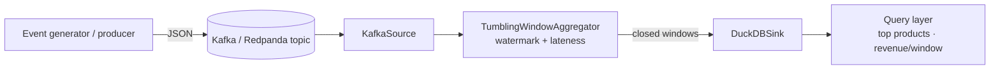

# realtime-data-pipeline — streaming event analytics

> Ingest order events from **Kafka**, aggregate them into **tumbling time
> windows** with watermark-based completion, and land the results in a
> **DuckDB** warehouse you can query. The windowing/watermark core is pure and
> fully unit-tested — no broker or database required to run the suite.


> ℹ️ An **original reference implementation** demonstrating streaming
> data-engineering practices. No proprietary code or data.

---

## Architecture



- **Ingest** — `OrderEvent`s (Pydantic-validated) are produced to a Kafka topic.
  Any iterable of events is a valid source, so Kafka and an in-memory list are
  interchangeable.
- **Process** — a `TumblingWindowAggregator` buckets events into fixed windows
  and, driven by a **watermark** (`max(event_time) - allowed_lateness`), releases
  each window exactly once when it closes. This is the part that's easy to get
  subtly wrong — so it's pure code with no I/O and the bulk of the tests.
- **Store** — completed windows are written to **DuckDB** with
  `INSERT OR REPLACE` keyed on window identity, so replays are idempotent.
- **Query** — top products by revenue, revenue per window, totals.

## Why these choices

- **Watermark-driven windowing over "aggregate everything then dump"** — results
  stream out as windows close, and late events within the lateness budget are
  still counted.
- **Pure processing core, pluggable I/O** — the aggregator doesn't import Kafka
  or DuckDB, so the hard logic is tested in milliseconds without infrastructure.
- **DuckDB as the warehouse** — a real analytical engine (columnar, SQL) that
  needs zero services to run locally or in CI.
- **Redpanda in Compose** — Kafka-compatible, single container, no ZooKeeper.

---

## Run the demo (no Kafka, no Docker)

```bash
pip install -e ".[dev]"
python -m pipeline demo --count 500 --window 60
```
Generates 500 events across an advancing timeline, runs the full
source -> window -> warehouse path in-memory, and prints top products and
revenue per window.

## Run the real streaming path (Kafka via Docker)

```bash
docker compose up --build
# redpanda broker + a producer (500 events -> topic) + a consumer
# (topic -> windowed aggregates -> ./data/warehouse.duckdb)

# then query the landed warehouse:
python -m pipeline query --db ./data/warehouse.duckdb
```

## CLI

| Command | What it does |
| --- | --- |
| `pipeline demo` | In-memory end-to-end run + report |
| `pipeline produce` | Publish synthetic events to Kafka |
| `pipeline consume` | Kafka -> windowed aggregation -> DuckDB |
| `pipeline query` | Report metrics from a warehouse file |

---

## Tests

```bash
pytest -q
```
Covers event validation, window flooring, the aggregator's `flush_completed`
watermark semantics (only closed windows are released), the DuckDB sink and its
idempotent writes, and an end-to-end streaming run with asserted aggregates —
all without a broker or external database.

---

## Project layout

```
src/pipeline/
  events.py     # OrderEvent (Pydantic)
  windows.py    # tumbling windows + watermark flush  (pure core)
  sinks.py      # DuckDB warehouse + queries
  sources.py    # InMemorySource, KafkaSource
  producer.py   # Kafka producer
  runner.py     # source -> aggregator -> sink loop
  generate.py   # deterministic synthetic events
  cli.py        # demo / produce / consume / query
```

---

*An original reference implementation. No proprietary code, data, or confidential information is included.*
